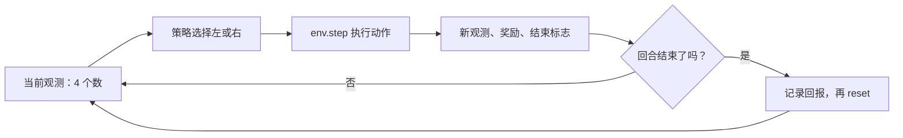

# CartPole：从一次交互理解强化学习

这个项目只用一个 Python 主文件，通过 Gymnasium 的 `CartPole-v1` 和
Stable-Baselines3 的 PPO 学习让杆保持竖直。使用 CPU，不自行实现 PPO。

## 先看什么

1. 打开 `outputs/cartpole_ppo.gif`，看看学到的行为。
2. 读 `cartpole.py` 的 `evaluate()`：先理解一次回合如何进行。
3. 对照 `action_space.sample()` 与 `model.predict(obs)`：两者唯一的决策差异在哪里？
4. 再读 `train()` 和 `load_model()`：理解参数从哪里来、如何保存和使用。
5. 最后读 `replay()`：理解画面只是把状态显示出来。

环境负责模拟小车和杆，并告诉我们动作的后果；策略负责选动作；PPO 负责改进策略。
训练开始时网络还没学会平衡，随着交互和参数更新，策略可能越来越擅长让回合持续。

## 本次实际运行结果

2026-09-24，在本项目的 CPU 环境中请求训练 50000 步，实际完成 51200 步。
从保存的模型重新加载，在独立环境实例中评估得到：

| 策略 | 评估回合数 | 平均回报 ± 标准差 | 回合结束情况 |
| --- | --- | --- | --- |
| 随机策略 | 10 | 25.4 ± 10.7 | 10 次失败终止 |
| PPO | 10 | 500.0 ± 0.0 | 10 次到达 500 步上限，无失败终止 |

另一个初始状态的动画回放也得到 500 分。上述数字是本次固定种子的结果，
不是对以后每次实验的承诺；重新运行会更新 `outputs/`，此处的历史记录不会自动变化。

- [训练后的 GIF](outputs/cartpole_ppo.gif)
- [保存的 PPO 模型](outputs/ppo_cartpole.zip)
- [随机策略逐回合结果](outputs/random_eval.json)、[PPO 逐回合结果](outputs/ppo_eval.json)

本次使用 Python 3.11.16、Gymnasium 1.2.3、Stable-Baselines3 2.7.1、PyTorch 2.8.0+cpu。

## 已有的独立环境

项目路径：`/home/hxy/RL/cartpole_ppo`。

| 文件或目录 | 用途 |
| --- | --- |
| `cartpole.py` | 全部学习代码，带中文注释 |
| `README.md` | 阅读路线、实验说明和小练习 |
| `setup.sh` | 创建环境并安装依赖 |
| `run.sh` | 显式调用项目环境中的 Python |
| `requirements.txt` | 固定直接依赖版本，包含 CPU 版 PyTorch |
| `requirements-lock.txt` | 安装后记录的全部 Python 包版本 |
| `.tools/bin/micromamba` | 本项目使用的 micromamba |
| `.env/` | micromamba 创建的独立 Python 3.11 环境 |
| `.mamba/`、`.cache/` | 本项目自己的依赖缓存 |
| `outputs/` | 模型、逐回合结果、训练记录和动画 |

`run.sh` 无需激活环境。Python 使用 `-I` 隔离模式，不导入用户的 site-packages，
也不受现有 `PYTHONPATH` 影响。代码中的模型创建和重载均指定 `device="cpu"`。

安装脚本适用于当前的 Linux x86_64 机器。首次创建环境时，它使用本机已有的
`bwrap` 将项目以外的系统目录设为只读，并隔离 micromamba 的用户环境登记表；
不会执行 `shell init`、修改 `.bashrc` 或使用系统 pip。

## 分步运行

环境建好后，可以直接运行以下命令：

```bash
cd /home/hxy/RL/cartpole_ppo

bash run.sh random    # 随机选动作，跑 10 回合，得到对照结果
bash run.sh train     # 从头训练约 50000 步并保存模型
bash run.sh evaluate  # 从磁盘加载模型，在新环境里评估 10 回合
bash run.sh replay    # 从磁盘加载模型，生成一回合 GIF
```

也可以用 `bash run.sh all` 顺序完成以上四步。
有图形桌面时，`bash run.sh replay --human` 会打开实时动画窗口。
默认的 GIF 方式无需显示器和 ffmpeg，直接用浏览器或图片查看器打开即可。

在同类机器上重新创建环境时先运行 `bash setup.sh`。
默认安装固定的直接依赖；`requirements-lock.txt` 记录本次实际解析到的完整版本。
若要重现全部 Python 包版本，先用 `setup.sh` 建好环境，再执行：

```bash
.env/bin/python -I -m pip --isolated install --index-url https://pypi.org/simple -r requirements-lock.txt
```

CPU 版 torch 已由安装脚本提前装好。这里不需要额外安装 CUDA、Notebook 或 TensorBoard。

再次运行 `train` 会从头训练，并覆盖已有模型和训练记录；它不自动接着上次训练。
`random`、`evaluate` 和 `replay` 分别覆盖自己的结果文件，不更新模型。
如需保留某次实验，请先把 `outputs/` 复制为别的目录；重新训练后也应重新评估和生成动画。

## 读懂一次交互

可以先把注意力放在这一小段：

```python
obs, info = env.reset(seed=10000)
action = env.action_space.sample()
next_obs, reward, terminated, truncated, info = env.step(action)
```

`reset()` 开始一个回合，把小车和杆放到接近直立的随机初始状态。
`step(action)` 才推动模拟时间前进。决策时看当前 `obs`；执行动作后得到 `next_obs`，
再用它决定下一步。主文件中直接把返回值赋给 `obs`，表示更新“当前观测”。



### 观测：智能体能看到什么？

| 索引 | 含义 | 直觉 |
| --- | --- | --- |
| `obs[0]` | 小车水平位置，米 | 车离轨道中心多远 |
| `obs[1]` | 小车水平速度，米/秒 | 车正在向哪边、以多快速度移动 |
| `obs[2]` | 杆相对竖直方向的角度，弧度 | 杆目前倾斜多少 |
| `obs[3]` | 杆角速度，弧度/秒 | 杆正在以多快速度转动 |

网络接收的是这 4 个数。GIF 中的像素没有参与决策。
只看角度往往不够：相同倾角的杆，可能正在回正，也可能正在加速倒下。
速度让策略能区分这两种情况。

### 动作：智能体能控制什么？

`0` 表示向左施力，`1` 表示向右施力。没有“静止”动作，也不直接指定杆的角度。
向左施力不等于小车立即向左运动：如果车原本正向右运动，它可能先减速。

随机策略用 `env.action_space.sample()` 等概率选动作，完全忽略观测。
训练后的策略用 `model.predict(obs, deterministic=True)` 选择当前概率最大的动作。
`deterministic=True` 固定的是“同一观测下怎么选动作”，环境的初始状态仍可以变化。

### 奖励和回报：什么叫做得好？

默认每执行一步奖励就是 `+1`，包括失败的最后一步。
单步 `reward` 是即时反馈；本回合累计的 `episode_return` 是回报。
因此得到 30 分就是走了 30 步，得到 500 分就是撑到了时间上限。

这里没有每一步的“标准答案动作”。PPO 从交互结果中学习哪些决策更有利于后续回报；
它内部还会使用折扣回报和价值估计，这些算法细节暂时交给 SB3。

### 一个回合什么时候结束？

| 返回值 | 在本项目中的意思 |
| --- | --- |
| `terminated=True` | 小车位置超出 ±2.4 米，或者杆角度超出约 ±12°，任务失败 |
| `truncated=True` | 已运行 500 步，触及外部时间上限 |

任意一个为真，都应停止本回合并在下一回合调用 `reset()`；两者也可能同时为真。
因此代码检查 `terminated or truncated`，而不是只检查杆是否倒下。
`observation_space` 的数值边界不是失败阈值，不能拿它代替上述结束条件。
学习时真正终止与时间截断的价值估计处理不同，SB3 会处理这一点。

## 训练与推理有什么区别？

| 阶段 | 关键调用 | 是否更新网络参数 |
| --- | --- | --- |
| 创建模型 | `PPO("MlpPolicy", train_env, device="cpu", ...)` | 初始化参数，还没学会任务 |
| 训练 | `model.learn(total_timesteps=...)` | 是，采集经验并反复优化 |
| 保存 | `model.save(MODEL_PATH)` | 否，把模型状态写入 ZIP |
| 重载 | `PPO.load(MODEL_PATH, device="cpu")` | 否，恢复已保存的模型 |
| 推理 | `model.predict(obs, deterministic=True)` | 否，用现有参数选动作 |

`MlpPolicy` 是适合数值向量的多层感知机。PPO 训练中既有选动作的策略网络，
也有估计未来回报的价值网络；本项目使用库的默认结构。
你暂时只需要掌握：`learn()` 会学，`predict()` 会用；评估 10 个回合不会让模型继续变强。

`train()` 结束后不会返回内存中的模型对象。`evaluate` 和 `replay` 都必须执行
`load_model()`，所以分开运行命令也能验证保存和重载真的有效。

`total_timesteps=50000` 指环境交互步数，不是 50000 回合。
PPO 默认每批采集 2048 步，完整批次结束才停止，因此请求 50000 步通常实际运行 51200 步。
一个批次可以跨越多个回合。`training.json` 记录请求值和实际值。

训练输出中的 `rollout/ep_rew_mean` 是近期训练回合的平均奖励，涉及训练时的动作采样。
它不同于最后独立评估的 10 回合平均奖励。第一次阅读时先关注回合奖励和总步数即可。

## 怎样公平比较结果？

训练种子是 `42`；评估使用 `10000` 到 `10009`；动画使用 `20000`。
随机策略和 PPO 在分别新建的环境里使用相同的评估种子，从相同初始状态出发。
动作不同后，后续轨迹当然也会不同。随机动作的生成器也单独设置了种子。

这里的“独立评估环境”指新建的 Gymnasium 环境实例，与训练环境隔离，
不需要再创建第二套 Python 虚拟环境。评估循环显式写出，方便看到每一步如何处理。

查看 `outputs/random_eval.json` 和 `outputs/ppo_eval.json`，比较每回合回报、均值和标准差。
标准差描述这 10 个结果的离散程度，不是置信区间。10 回合是入门实验的小样本，
不能据此保证任意初始状态都能成功；固定种子方便复现，跨平台或版本仍可能有差异。

GIF 只展示一个新初始状态下的表现，不能代替这 10 回合的统计结果。

## 三个小练习

1. **先预测，再验证**：如果所有动作都改成 `0`，小车会怎样？在随机策略分支里
   暂时替换 `action_space.sample()`，跑 `random` 后恢复代码。观察逐回合的结束标志。
2. **看看观测在说什么**：在 `env.reset()` 后暂时加 `print(obs)`，把 4 个数字和上表对应起来。
   特别留意角度是弧度，不能把 `0.1` 误读成 `0.1°`。
3. **区分训练量和评估量**：先备份现有 `outputs/`，再执行
   `bash run.sh all --timesteps 10000`，与 50000 步的结果比较。
   两次评估都是 10 回合，改变的是训练经验量；更多训练也不保证每次都单调变好。

读完后试着自己解释：为什么随机策略同样能得到奖励？为什么到 500 步需要 reset？
为什么动画播放很多遍也不会训练模型？答案分别落在奖励规则、回合边界、`learn/predict` 的区别上。

## 官方参考

- [Gymnasium CartPole：观测、动作、奖励和结束规则](https://gymnasium.farama.org/environments/classic_control/cart_pole/)
- [Gymnasium step/reset 接口](https://gymnasium.farama.org/api/env/)
- [Stable-Baselines3 PPO：训练、保存、加载和 CPU 使用](https://stable-baselines3.readthedocs.io/en/master/modules/ppo.html)
- [micromamba 手动安装](https://mamba.readthedocs.io/en/latest/installation/micromamba-installation.html)
